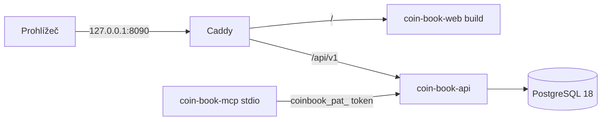

# 100 – Přehled architektury

Import: soubor → detekce formátu → parser → kontrola součtů → deterministická ID → jedna DB transakce (COPY do staging, `INSERT … ON CONFLICT DO NOTHING`, kategorizace pravidly a nápovědou banky, párování převodů). Měřeno: 10 000 řádků za ~0,45 s.
